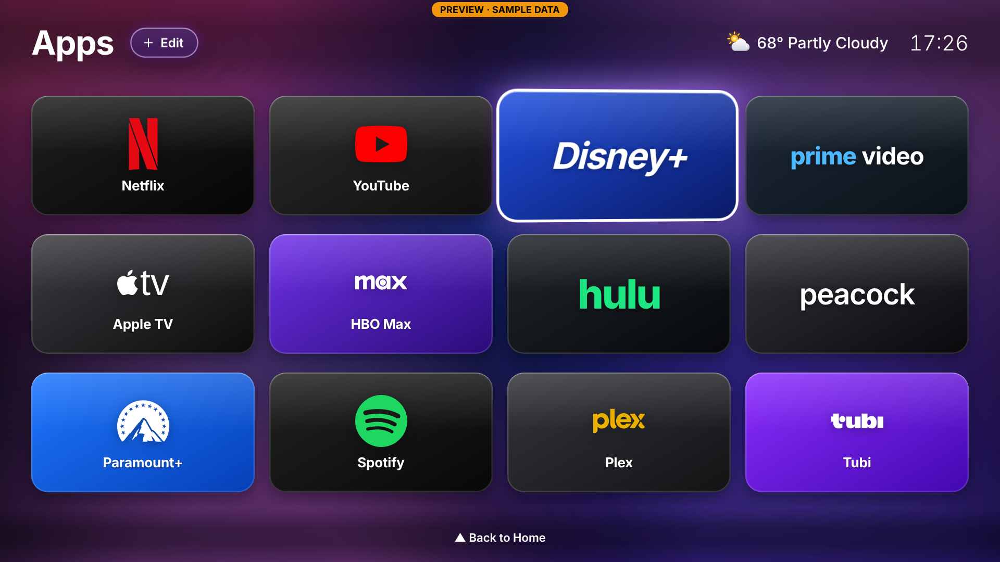
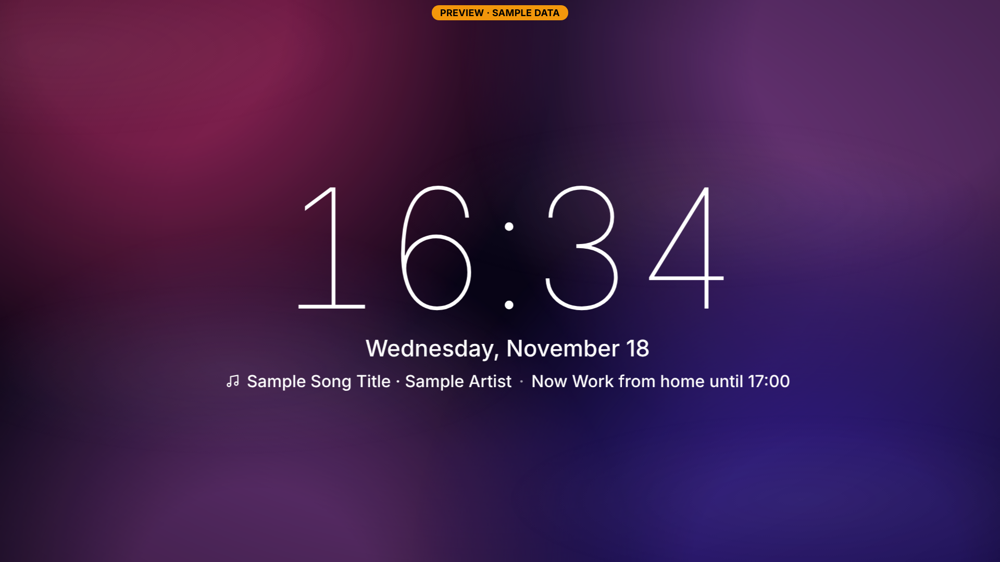

# Widgetapp TV

An Apple-inspired home screen for Samsung (Tizen) TVs: your iCloud calendar, weather and a set of
widgets on a themed, glass-style background, with a page of streaming apps one press of Down away.
It is plain HTML, CSS and JavaScript with no build step.


| Apps page | Ambient Mode |
|---|---|
|  |  |

It shows:
- **Up Next:** your iCloud calendar
- **Weather:** current conditions and the next 12 hours, in °F with 24-hour times (both can be changed)
- **Widgets:** Sun & Moon, Guest Wi-Fi QR code, Birthdays & Holidays, Commute, NASA Picture of the Day, Air & UV, Countdown, Spotify Now Playing (a double-width tile, with album-colored glow and animated bars)
- **Severe weather alerts:** shown as a banner
- **Alive background:** the screen takes the colors of the album that is playing, shows rain, snow, clouds or stars to match the weather, and turns into a calm floating clock (with your photos as a slideshow) when nobody is using the remote
- **Theme button:** 23 themes (13 single-color, 10 colorful; Purple is the default) plus photo backgrounds, and Light/Dark/Auto appearance. The theme colors the background, tints the cards, and colors headings, highlights and buttons.

## Try it on your Mac first (no setup)

Open Terminal **in this folder** (type `cd `, drag the folder from Finder into the Terminal window, press Return; `ls` should list `index.html`) and run:

```bash
python3 tools/serve.py
```

Then open **http://localhost:8765/index.html?demo=1** in Safari or Chrome. Preview mode fills
everything with **sample data** (it says so at the bottom of the screen). Use the arrow keys,
Return (OK) and Esc (Back) to act like the TV remote.

Without `?demo=1`, it uses your real settings from `config.local.js` (copy `config.local.example.js` to
`config.local.js` first, see below). `tools/serve.py` is a small server that also fetches your iCloud calendar for the page (browsers refuse to read iCloud directly, which otherwise shows "Couldn't load … Failed to fetch"); it only ever fetches icloud.com addresses.

## Using it with the remote

| Button | What it does |
|---|---|
| Arrows | Move between cards and buttons. Pressing ▶ or ▼ past the last widget shows the next page of widgets. |
| OK | Opens the focused card full screen (big Spotify player, big Wi-Fi QR code, full calendar, and so on) |
| Back | Closes the full-screen view or panel |
| Yellow button | Theme (same as the round palette button, top right) |
| Blue button | Settings (same as the round gear button, top right) |
| Play/Pause, Next, Previous | Control Spotify from anywhere |

If you don't press anything for 15 seconds, the focus highlight disappears so the screen stays clean.
Up to 6 widgets fit on screen at once. Tiles stay large while they fit in one row, and switch to two
rows of smaller tiles when more are showing. If there are more than fit on one screen, they split
evenly into pages that rotate every 20 seconds. The dots show which page you're on.

## The Apps page (streaming apps)

Press **Down** past the last row of widgets and the whole screen slides up to a page of app tiles, like the Apple TV home screen. Press **Up** (from the top row of tiles you reach **Edit**; Up again, or **Back**, goes home).
Press OK on a tile to open that app (this only works when the dashboard is installed on the TV, see Setup 4B). The tiles are four across and three rows show at a time; if you add more, the rows slide.

- **Add or remove apps:** press **Edit** at the top of the page (or **Settings → Apps → Add or Remove Apps**). Every service the dashboard knows is listed with its logo: turn one **On** to put it on the page, **Off** to take it away, and use the arrows to change the order. 28 services are known (12 are on to start with: Netflix, YouTube, Disney+, Prime Video, Apple TV, HBO Max, Hulu, Peacock, Paramount+, Spotify, Plex, Tubi; the rest include Crunchyroll, Twitch, Apple Music, YouTube Music, YouTube TV, Vimeo, TIDAL, Fubo, Pandora, SoundCloud, Deezer, Kick, DAZN, Kodi, Pluto TV and ESPN).
  On the TV, the editor also lists the other apps the TV reports; press **Add** for one to give it a tile of its own (a letter tile), and the trash button removes it again.
- **How it finds your apps:** Samsung doesn't publish the IDs of the built-in apps, and they can differ between TVs. So the dashboard asks the **TV** which apps are installed and matches them by name. When the TV answers, only the apps you really have are shown.
  If it can't answer, the ones that are on are all shown and a few built-in IDs from an unofficial list are tried (**unverified**: they may not match your TV). **Find Apps on This TV** (in the editor and in Settings) shows exactly what the TV reports (names and IDs).
- **Fix or add an app** in `config.local.js`: `c.apps = [{ name: 'Crunchyroll', id: 'THE.APP.ID', color: '#f47521' }];` (a service with the same name keeps its logo and gets your ID; listing it there also turns it on).
- **Logos:** each tile uses the service's icon in its own color on its brand-colored tile. The icons come from [Simple Icons](https://simpleicons.org) (version 16.38.0, public domain, CC0). Disney+, Prime Video, Hulu, Peacock, Pluto TV and ESPN are not in that set, so their tiles show a plain text wordmark instead; they are **not** the official artwork.
  The names and logos are trademarks of their owners; they are only used to show which app a tile opens, and this project is not affiliated with or endorsed by any of them. To use an official logo of your own, put a PNG at `images/apps/<key>.png` (for example `images/apps/disney.png`); it replaces the built-in artwork. The keys are the lower-case service names without spaces: `netflix`, `youtube`, `disney`, `prime`, `appletv`, `hbomax`, `hulu`, `peacock`, `paramount`, `spotify`, `plex`, `tubi`, `crunchyroll`, `twitch`, and so on (see `js/appmatch.js`).
- **The slide:** one long, soft ease-out; while it runs the blur, shadows and background motion are paused so it stays smooth. In a slow software-rendered test browser that cut the average frame time from 72 to 54 ms and the very slow frames (over 100 ms) from about 5 to 1 per slide; a TV's own hardware will behave differently, so judge it on the TV. The page also tints its background with the color of the app you have selected.
- **Not tested on a real TV** by the author: opening apps and listing them are Samsung TV features that can't be reached from where this was built. If a tile doesn't open its app, Find Apps on This TV shows what the TV reports.

## Customize (Settings, the gear button)

Everything here is changed with the remote and saved on the TV. **Reset Look to Defaults** puts it all back.

| Section | Option | Choices (default first) |
|---|---|---|
| Clock | Style | Thin (hairline digits with a fine rule under them), Bold, Outline (hollow digits) |
| | Size | Medium, Small, Large |
| | Time Format | 24-Hour, 12-Hour (applies to every time in the app) |
| | Show Seconds | Off, On |
| Layout | Widgets on Screen | 6 Compact (3 × 2), 4 Medium (2 × 2), 3 Large (one row) |
| | Calendar Side | Left, Right |
| | Wide Spotify Tile | On (Spotify takes two tile slots), Off (one slot) |
| Glass & Outlines | Outline | Theme Glow, Crisp (white, or dark in light mode), Subtle |
| | Outline Thickness | Medium, Thin, Thick |
| | Glass | Frosted, Solid |
| | Corners | Round, Soft, Square |
| | Glow Around Panels | On, Off |
| | Moving Background | On, Off |
| Panels | Up Next Shows | 7 Days, 3 Days, 14 Days |
| | Forecast Length | 12 Hours, 6 Hours, 8 Hours |
| | Temperature | °F (wind in mph), °C (wind in km/h) |
| | Weather stats | High · Low, Feels Like, Humidity and Wind can each be turned off |
| Smart & Motion | Animations | Full, Reduced (simple fades only), Off |
| | Greeting | On, Off ("Good evening" before the date) |
| | Dim After Sunset | On, Off |
| | Album Art Background | On, Off |
| | Weather Effects | On, Off |
| | Ambient Mode | After 10 Min, After 5 Min, After 30 Min, After 1 Hour, Off |

Below those are **Widgets** (turn each on or off, and reorder), **Calendars** and **Location**.

Two limits, both for readability from a couch: Frosted is as see-through as the glass gets, and there
is no 8-tile grid.

### What the screen works out for you

Everything here comes from the calendar and weather the app already loads. Nothing extra to set up.

- **Under the clock:** at most two short items, most important first: the event happening now, a rain
  heads-up, the next event with a countdown ("Dentist in 25 min"), a sunrise or sunset countdown, and
  the current weather. It never shows more than two. An event starting within 10 minutes is marked
  **Soon** and jumps ahead of the rain line. After 20:00 tomorrow's weather replaces today's.
- **Rain heads-up:** the forecast is hour by hour, so it says "Rain likely within the hour", "Rain likely
  from 20:00" or "Rain until about 16:00". It counts an hour as rainy at a 50% chance or more, and only
  shows when rain is within the next 6 hours.
- **Up Next:** the next event today shows "in 25 min", the current event has a thin progress line, and
  the title says how many events are left today ("2 left today", "Done for today").
- **Sun & Moon:** shows "Sunset in 1 h 20 min" in the 90 minutes before sunrise or sunset, and a small
  arc shows where the sun is in its path today.
- **Spotify:** the glow, progress bar and animated bars take their color from the album art (the bars
  stop when playback is paused). If the art cannot be read, the theme color is used instead. The color
  is always adjusted so it stays readable on every theme.
- **Tile layout:** a double-width tile (Spotify) counts as two slots. Rows are filled so
  no row is over-full: with Spotify and two or three small tiles, the small tiles share the top row and
  Spotify gets its own row below. If only one other tile is on, it sits beside Spotify.
- **Time of day:** the background gets a warm wash around sunrise and sunset and a cool one at night,
  and after sunset the screen dims a little (dark mode only, and you can turn it off).
- **Clock:** the line under the digits is a live seconds line (a bright segment crosses it once a
  minute), the colon breathes, and when a digit changes only that digit slides in.
- **Album background:** while Spotify plays, four colors from the cover art replace the theme's colored
  lights (the colors are limited to the same brightness range the themes use, so text stays readable).
  Paused for more than 3 minutes, or grey/black/white art, and the theme comes back. Turn it off in
  Settings > Smart & Motion > Album Art Background.
- **Weather effects:** thin rain streaks (drizzle, rain, thunderstorm), snow, fog, drifting clouds, a few
  stars on a clear night in Dark mode, or a warm glow on a clear day. They are faint and only use fades and
  movement. Animations Reduced keeps only the still ones, Animations Off shows none, and Weather Effects
  can be turned off. Switching off Moving Background also stops the falling ones.
- **Ambient Mode:** after 10 minutes (you can change it) without a button press the panels fade out and a
  big thin clock floats on the background with the date and a line (the song playing, or what the line under
  the clock would say). It drifts to a new spot every 90 seconds. If you added photos, they become a slideshow
  with a slow pan. The first button press only wakes the screen; play/pause and skip still control Spotify
  without waking it. It never starts while Settings or a full-screen view is open.
- **Slideshow:** with two or more photos in `images/wallpapers/`, pick **Slideshow** on the theme screen. Each
  photo fades into the next every 2 minutes with a slow pan.
- **Day strip:** a thin time line under Up Next with today's timed events as colored blocks, past ones dimmed,
  and a marker for now. It starts at 08:00 and ends at 20:00 unless an event falls outside that.
- **Air & UV widget:** UV index and air quality (US scale) with a gauge for each and the level in words
  (for example "6 High", "42 Good"). Full screen view adds a tip and the exact scale. If your area has no value
  for one of them, that row is left out.
- **Countdown widget:** big day count to the next thing you are looking forward to. Easiest way: make a
  calendar event titled **Countdown: Beach trip** (or start the title with the hourglass emoji) from your
  phone, and it appears here, up to a year ahead. You can also list them in `config.local.js` (`c.countdowns`).
  The widget stays hidden until there is one.
- **Event cards:** each event in Up Next is a card with a side bar in the calendar's color, a big start time, and a chip with how long it lasts. The event happening now has a ring that fills as it goes and shows the time left. All-day events are slim banners.
- **Weather illustrations:** the weather icons are soft shaded drawings (sun glow, puffy clouds, drops, snowflakes, lightning) that work in Light and Dark mode. The big one in the weather panel moves very gently; Animations Reduced or Off keeps it still.
- **Rain radar widget:** a looping map of rain near you, on a page of its own so the map is tall (it rotates in with the other pages like any widget) (last two hours, plus forecast frames when the service has them), with a pin on your place. Radar images are from **RainViewer**, whose free service is for personal and educational use and asks for a credit, which is always shown on the map. The base map is a Mapbox picture using your Mapbox token (without one, the radar is drawn on a plain backdrop). OK opens a big view: OK plays or pauses, Left and Right step through the frames. It checks for new radar every 10 minutes and hides itself if it can't get any.
  **Not tested against the live service by the author.** One third-party source says RainViewer's free tier was restricted in 2026 (zoom limit, one color scheme, no forecast frames), which I couldn't confirm; the dashboard uses zoom 7 (twice as close as the earlier zoom 6) and works without forecast frames. In one test with a real location, RainViewer served every zoom-7 tile.
- **Commute map:** with a Mapbox token the Commute widget also shows a small map of your route (orange line, pins A and B), and a larger one in its full-screen view. If the picture can't load, the widget stays text-only. Not tested against Mapbox by the author.
- **Depth:** the background drifts a few pixels the opposite way to whatever you select, so the panels feel like they float in front of it (and Apps tiles lean toward the way you moved). It follows the Animations setting (Full only) and Moving Background.
- **Selection glow:** one soft glow slides from the panel you leave to the panel you select.
- **Motion:** the screen opens with the panels rising into place, tiles fade in when the widgets
  rotate, and a number that changes (temperature, drive time) brightens for a moment. Everything uses
  only fades and movement, which are the cheapest things a TV browser can draw. If anything looks
  choppy on your TV, set **Animations** to Reduced or Off.

---

## Setup

### 1. Get your iCloud calendar link

**On a Mac:** open Calendar. In the sidebar, right-click a calendar and choose **Share Calendar…**,
tick **Public Calendar**, then copy the link (it starts with `webcal://`).

**On an iPhone:** Calendar → **Calendars** → tap ⓘ next to a calendar → turn on
**Public Calendar** → **Share Link…** → Copy.

Do this for each calendar you want on the TV.

> ⚠️ A public calendar link is read-only, but **anyone who has the link can see those events**.
> Don't post it anywhere.

### 2. Put your info in `config.local.js`

Copy `config.local.example.js` to `config.local.js`, open it in a text editor, remove the `//` in front
of the lines you want, and fill them in. `config.local.js` and `spotify.local.js` are listed in
`.gitignore`, so your links and tokens are never committed:

```js
c.calendars = [
  { url: 'webcal://p00-caldav.icloud.com/published/2/XXXX', name: 'Home', color: '#ff9500' },
  { url: 'webcal://p00-caldav.icloud.com/published/2/YYYY', name: 'Work' }
];
c.wifi = { ssid: 'MyGuestWiFi', password: 'secret123', security: 'WPA' };
c.birthdays = [{ name: 'Mom', date: '05-14' }];
```

Each setting is optional:

| Setting | What it's for | Where to get it |
|---|---|---|
| `c.location` | Fixes the weather location. Leave it out to detect it automatically (accurate to about your city). | Latitude/longitude from Apple Maps or Google Maps |
| `c.wifi` | Guest Wi-Fi QR code. The QR code is made on the TV and never sent anywhere. | Your router |
| `c.birthdays` | Birthdays that aren't in your calendar. Calendar events with "birthday" in the title are found automatically. | — |
| `c.commute` | Drive time with live traffic. It only shows during `showFrom`–`showUntil` (06:00–10:00 by default). | Free token from https://account.mapbox.com |
| `c.nasaApiKey` | NASA Picture of the Day. Works without a key, but the shared `DEMO_KEY` has low limits. | Free key from https://api.nasa.gov |
| `c.wallpapers` | Your own background photos. Put the image files in `images/wallpapers/`, then list their file names. With two or more, the theme screen offers a **Slideshow**, and Ambient Mode shows them as a photo frame. | — |
| `c.countdowns` | Days to look forward to: `[{ name: 'Beach trip', date: '2026-12-20' }, { name: 'Anniversary', date: '06-14' }]` (`MM-DD` repeats every year). You can also add them from your phone, see Countdown below. | — |

You can also add calendars and change the location on the TV under **Settings**. Typing long links
with a remote is slow, though, so `config.local.js` is easier.

### 3. Spotify (optional, needs Spotify Premium)

Since February 2026, Spotify only lets personal developer apps work for **Premium** accounts.

1. Go to https://developer.spotify.com/dashboard and sign in, then click **Create app**.
2. Set the **Redirect URI** to exactly `http://127.0.0.1:8888/callback` and tick **Web API**.
3. Copy the app's **Client ID**.
4. In Terminal, in this folder, run (needs Node.js 18+ from https://nodejs.org):

   ```bash
   node tools/spotify-login.mjs YOUR_CLIENT_ID
   ```

5. Sign in when the browser opens. The tool writes `spotify.local.js`. Keep that file private.

**Shortcut (already set up with your Client ID):** double-click **`Spotify Sign-In.command`** in this
folder. It runs the same command for you. If macOS says it can't be opened because it's from an
unidentified developer, Control-click it → **Open** → **Open**.

**HomePods:** Samsung TVs can only *receive* AirPlay, so the TV can't send music to your HomePods.
Keep choosing your HomePods from your iPhone's AirPlay menu. The TV shows what's playing and can
pause and skip.

### 4. Get it on your Samsung TV

There are two ways. Do **A** first: it takes five minutes and nothing is installed on the TV.

**A. Try it on the TV right now (no installing)**

1. Make sure your Mac and your TV are on the same Wi-Fi.
2. Double-click **`Start TV Preview.command`** in this folder. (If macOS says it can't be opened, Control-click it, then **Open**.)
   It prints an address like `http://192.168.1.20:8765/index.html`.
3. On the TV, open the **Internet** (browser) app, type that address, and press OK. Add `?demo=1` to the end to see sample data instead of your own.

Limits: the browser's own bars show, your Mac has to stay on, and **apps cannot be opened from a browser**, so the Apps page only explains that (that needs B).
While it runs, anyone on your home Wi-Fi could read the app's files, including `config.local.js`, so close the window when you are done.

**B. Install it as a real app (stays on the TV)**

You need **Tizen Studio** (Samsung's free tool) and a free **Samsung account**. Before you start, write down:

- **Your TV's model and year:** Settings → Support → About This TV. Samsung's steps differ a little between TV years, and Samsung's guide is the reference:
  https://developer.samsung.com/smarttv/develop/getting-started/using-sdk/tv-device.html
- **Your Mac's chip:** Apple menu → About This Mac. Tizen Studio is made for Intel Macs. On an Apple silicon Mac (M1 and newer) it runs through Rosetta 2, which macOS offers to install, and Samsung's TV *emulator* does not work there.
  You do not need the emulator, because you install straight onto the real TV. (This comes from older Samsung forum posts, so check Samsung's page for the current state.)

**a. Install Tizen Studio**
1. Download Tizen Studio for macOS from https://developer.tizen.org/development/tizen-studio/download
2. Open **Package Manager** (it opens after installing). On the **Extension SDK** tab, install
   **TV Extensions** and **Samsung Certificate Extension**.

**b. Turn on Developer Mode on the TV**
1. Find your Mac's IP address: System Settings → Wi-Fi → Details (e.g. `192.168.1.20`).
2. On the TV, open **Apps**. With the remote, enter **1 2 3 4 5**.
3. Turn **Developer mode** On, enter your Mac's IP, then press OK.
4. Restart the TV: hold the power button until it turns off and back on.
5. Find the TV's IP address: Settings → General → Network → Network Status → IP Settings.

**c. Connect Tizen Studio to the TV**
1. In Tizen Studio: **Tools → Device Manager** → **Remote Device Manager** → **+**.
2. Enter any name and the TV's IP (port `26101`), then turn **Connection** on.

**d. Create a Samsung certificate**
1. **Tools → Certificate Manager → +** → choose **TV** → **Samsung** → create a new certificate profile.
2. Sign in with your Samsung account when asked. The TV must be connected (step c) so its ID is
   added to the certificate.

**e. Build and install**
1. **File → New → Tizen Project → Template → TV → Web Application → Basic Project**. Name it
   `Dashboard` and click Finish.
2. In Finder, copy **everything in this folder** into the new project's folder (Tizen Studio shows
   where it is). Replace files when asked. This includes `config.xml`, `index.html`, `icon.png`,
   `css/`, `js/`, `images/`, `config.local.js` and `spotify.local.js`.
3. Right-click the project → **Run As → Tizen Web Application**. The app installs and opens on the TV.

From then on it's in the TV's Apps list as **Dashboard**. After you change `config.local.js` or
`spotify.local.js`, copy them into the project again and repeat **Run As** to update the TV.

**If something goes wrong**

- **"Install failed" or a certificate error:** the certificate has to be created while the TV is connected (step c), with the same Samsung account. Make a new certificate profile and try again.
- **Tizen Studio can't see the TV:** the Mac and the TV must be on the same network; the IP typed into the TV's Developer Mode screen must be your **Mac's**, and the IP in Device Manager must be the **TV's**. Restart the TV after changing Developer Mode.
- **The app opens but looks empty or wrong:** open the same folder with A above. If it works there, a file was missed when copying into the Tizen project; copy everything again.
- **Apps page can't open apps:** the app asks the TV for permission to see and open apps (listed in `config.xml`). After updating the files, repeat **Run As** so the TV picks up the new permissions.
- **Still stuck:** tell me (1) your TV model and year, (2) your Mac's chip, and (3) the exact error text or a photo of the step that failed.

> Note: the author could not run Tizen Studio or reach a Samsung TV while building this, so the steps above follow Samsung's published process and have not been tried on a real TV.

### 5. If the calendar doesn't load on the TV

If weather works but the calendar says **"Couldn't load … (Failed to fetch)"**, the browser is blocking
the request to iCloud (a "CORS" error).
- **Opened through `tools/serve.py` or `Start TV Preview.command`:** nothing to do, the calendar goes through that server. If you started the page with plain `python3 -m http.server`, use `python3 tools/serve.py` instead.
- **Installed on the TV (Setup 4B):** the TV app usually doesn't need a proxy. If it still fails, set up the small free proxy in `proxy/README.md`.

---

## What each part uses

| Feature | Service | Cost / key |
|---|---|---|
| Calendar | Your iCloud public calendar link | Free |
| Weather, sunrise/sunset, city search | Open-Meteo | Free, no key |
| Auto location | ipapi.co (backup: GeoJS) | Free, no key |
| Weather alerts | US National Weather Service (US locations only) | Free, no key |
| Holidays | Nager.Date | Free, no key |
| Air quality and UV | Open-Meteo air-quality service | Free, no key |
| Rain radar | RainViewer (weather-maps index and tiles) | Free for personal use, credit shown on screen |
| Maps (commute route, radar base map) | Mapbox Static Images, same token as Commute | Free token from https://account.mapbox.com |
| Commute | Mapbox Directions with traffic | Free tier, needs a token |
| Space photo | NASA APOD | Free, key recommended |
| Spotify | Spotify Web API | Needs Spotify Premium |

## Not possible on a Samsung TV

Apple Reminders, Apple Home/HomeKit controls, and Apple Music "now playing" have no way for a TV
app to connect to them.

## Files

```
index.html            the screen
config.local.example.js    copy to config.local.js and edit (config.local.js is git-ignored)
spotify.local.example.js   the Spotify sign-in tool writes spotify.local.js (git-ignored)
config.xml            Samsung/Tizen app manifest
css/styles.css        the look (Apple-style frosted cards, light/dark)
fonts/                the Inter typeface and its license
js/                   app code (appmatch.js = the streaming services, logos.js = their icons, ics.js = calendar reader, smart.js = countdowns, rain, UV and air levels, palette.js = album colors, widgets/ = each widget)
images/art/           the built-in artwork (drawn wallpapers)
images/wallpapers/    put your own background photos here
images/apps/          optional PNG logos for the Apps page (<key>.png)
tools/                Spotify sign-in tool
proxy/                optional calendar proxy (Cloudflare Worker)
test/                 automated checks (not needed on the TV)
```

## Design notes

- The look is modeled on Apple TV and visionOS glass: a calm colored environment, frosted glass panels
  with a bright top edge and soft shadow, and round floating buttons. Selecting a panel with the remote
  lifts it and lights its edge.
- Text contrast was measured against the worst case of every color in all 23 themes, on the tinted
  glass with the ambient lighting, the glass highlight and the sunset and night tints, in both light
  and dark mode:
  - main text at least 7.4:1
  - secondary text at least 5.1:1
  - the faintest text at least 4.7:1
  - theme-colored text (day labels, section headings) at least 5.1:1
  - white text on theme-colored buttons at least 4.7:1
  - text on lit rows (the current event, list cells in Settings) at least 5.0:1
  - the second accent (curve, progress lines) at least 3.6:1

  That meets Apple's accessibility guideline of 4.5:1 for small text. The clock's digits are lit from
  above (white fading into the theme color) and sit on a soft shadow (dark mode) or haze (light mode):
  at least 5.1:1 in dark mode and 7.4:1 in light mode on every theme. The date and the line under the
  clock are at least 6.1:1.
- Apple's guidelines suggest following the system's light/dark setting instead of an in-app switch.
  This app has one because you asked for it. **Auto** (the default) follows sunrise and sunset.
- Spacing follows one 8-pixel scale (gaps are 24 px, corner radii and padding are multiples of 8), and
  text uses a fixed set of seven sizes (18, 20, 22, 24, 28, 32, 40) apart from the big display numbers.
  Each theme has a second accent color (its main color turned 35 degrees) for the weather curve and
  progress lines, kept at least 3:1 against the glass.
- To reduce burn-in on OLED TVs, the layout moves a few pixels every 10 minutes.
- The app uses **Inter**, an open-source typeface in the style of Apple's San Francisco, bundled in
  `fonts/` under the SIL Open Font License (`fonts/OFL-LICENSE.txt`). Apple's own fonts can't be used
  on non-Apple devices, and without a bundled font the TV would fall back to its own font.

## Running the checks (optional, for developers)

```bash
TZ=America/Denver node test/ics.test.js      # calendar reader: 25 checks
node test/smart.test.js                      # countdowns, rain heads-up, sun countdown, greeting, "left today", sun arc, UV and air levels, day strip: 95 checks
node test/pack.test.js                       # tile packing, incl. the double-width tiles and the radar's own page: 39 checks
node test/palette.test.js                    # album-art colors and the brightness cap: 12 checks
node test/appmatch.test.js                   # the 28 services, finding them on the TV, the editor's list logic, tile readability: 59 checks
node test/radarmath.test.js                  # radar map-tile maths, frame picking, Mapbox map URLs: 42 checks
node test/apps-contrast.test.js              # readability of the text on the Apps page and the Edit button: 6 checks
python3 test/serve.test.py                   # the local server and its iCloud-only calendar helper: 13 checks
python3 -m http.server 8765 &                # then, with playwright, jsqr and pngjs installed:
node test/art.test.js                        # every built-in artwork is readable in Dark mode (same worst-case model as the themes): 8 checks
node test/ui.test.js                         # screen, remote, options, settings, pictures, Apps page, event cards, weather icons, radar, commute map, depth, selection glow, the app editor: 202 checks
```

## Credits and license

Code: [GNU GPL v3](LICENSE). The bundled [Inter](https://rsms.me/inter/) typeface is under the SIL Open
Font License (see `fonts/OFL-LICENSE.txt`). Weather data is from Open-Meteo and US National Weather
Service alerts; rain radar images from RainViewer; maps from Mapbox; photos from NASA's Astronomy Picture
of the Day; holidays from Nager.Date. Streaming service icons on the Apps page are from
[Simple Icons](https://simpleicons.org) (CC0); the names and logos are trademarks of their owners, shown only to
identify the app a tile opens, with no affiliation or endorsement.
