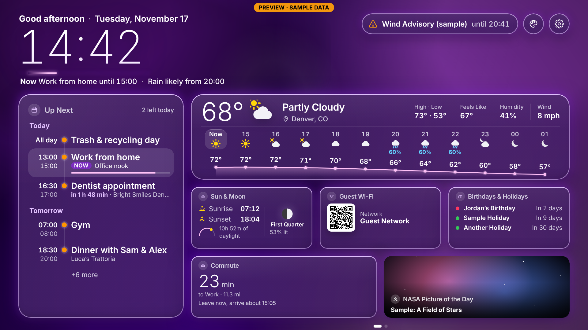

# Widgetapp TV

An Apple-inspired home screen for Samsung (Tizen) TVs: your iCloud calendar, weather and a set of
widgets on a themed, glass-style background. It is plain HTML, CSS and JavaScript with no build step.



It shows:
- **Up Next:** your iCloud calendar
- **Weather:** current conditions and the next 12 hours, in °F with 24-hour times (both can be changed)
- **Widgets:** Sun & Moon, Guest Wi-Fi QR code, Birthdays & Holidays, Commute, NASA Picture of the Day, Spotify Now Playing (a double-width tile, with album-colored glow and animated bars)
- **Severe weather alerts:** shown as a banner
- **Theme button:** 23 themes (13 single-color, 10 colorful; Purple is the default) plus photo backgrounds, and Light/Dark/Auto appearance. The theme colors the background, tints the cards, and colors headings, highlights and buttons.

## Try it on your Mac first (no setup)

Open Terminal in this folder and run:

```bash
python3 -m http.server 8765
```

Then open **http://localhost:8765/index.html?demo=1** in Safari or Chrome. Preview mode fills
everything with **sample data** (it says so at the bottom of the screen). Use the arrow keys,
Return (OK) and Esc (Back) to act like the TV remote.

Without `?demo=1`, it uses your real settings from `config.local.js` (copy `config.local.example.js` to
`config.local.js` first, see below).

## Using it with the remote

| Button | What it does |
|---|---|
| Arrows | Move between cards and buttons. Pressing ▶ or ▼ past the last widget shows the next page of widgets. |
| OK | Opens the focused card full screen (big Spotify player, big Wi-Fi QR code, full calendar, and so on) |
| Back | Closes the full-screen view or panel |
| Yellow button | Theme (same as the round palette button, top right) |
| Blue button | Settings (same as the round gear button, top right) |
| Play/Pause, Next, Previous | Control Spotify from anywhere |

If you don't press anything for 15 seconds, the focus highlight disappears so the screen stays clean.
Up to 6 widgets fit on screen at once. Tiles stay large while they fit in one row, and switch to two
rows of smaller tiles when more are showing. If there are more than fit on one screen, they split
evenly into pages that rotate every 20 seconds. The dots show which page you're on.

## Customize (Settings, the gear button)

Everything here is changed with the remote and saved on the TV. **Reset Look to Defaults** puts it all back.

| Section | Option | Choices (default first) |
|---|---|---|
| Clock | Style | Thin (hairline digits with a fine rule under them), Bold, Outline (hollow digits) |
| | Size | Medium, Small, Large |
| | Time Format | 24-Hour, 12-Hour (applies to every time in the app) |
| | Show Seconds | Off, On |
| Layout | Widgets on Screen | 6 Compact (3 × 2), 4 Medium (2 × 2), 3 Large (one row) |
| | Calendar Side | Left, Right |
| | Wide Spotify Tile | On (Spotify takes two tile slots), Off (one slot) |
| Glass & Outlines | Outline | Theme Glow, Crisp (white, or dark in light mode), Subtle |
| | Outline Thickness | Medium, Thin, Thick |
| | Glass | Frosted, Solid |
| | Corners | Round, Soft, Square |
| | Glow Around Panels | On, Off |
| | Moving Background | On, Off |
| Panels | Up Next Shows | 7 Days, 3 Days, 14 Days |
| | Forecast Length | 12 Hours, 6 Hours, 8 Hours |
| | Temperature | °F (wind in mph), °C (wind in km/h) |
| | Weather stats | High · Low, Feels Like, Humidity and Wind can each be turned off |
| Smart & Motion | Animations | Full, Reduced (simple fades only), Off |
| | Greeting | On, Off ("Good evening" before the date) |
| | Dim After Sunset | On, Off |

Below those are **Widgets** (turn each on or off, and reorder), **Calendars** and **Location**.

Two limits, both for readability from a couch: Frosted is as see-through as the glass gets, and there
is no 8-tile grid.

### What the screen works out for you

Everything here comes from the calendar and weather the app already loads. Nothing extra to set up.

- **Under the clock:** at most two short items, most important first: the event happening now, a rain
  heads-up, the next event with a countdown ("Dentist in 25 min"), a sunrise or sunset countdown, and
  the current weather. It never shows more than two. An event starting within 10 minutes is marked
  **Soon** and jumps ahead of the rain line. After 20:00 tomorrow's weather replaces today's.
- **Rain heads-up:** the forecast is hour by hour, so it says "Rain likely within the hour", "Rain likely
  from 20:00" or "Rain until about 16:00". It counts an hour as rainy at a 50% chance or more, and only
  shows when rain is within the next 6 hours.
- **Up Next:** the next event today shows "in 25 min", the current event has a thin progress line, and
  the title says how many events are left today ("2 left today", "Done for today").
- **Sun & Moon:** shows "Sunset in 1 h 20 min" in the 90 minutes before sunrise or sunset, and a small
  arc shows where the sun is in its path today.
- **Spotify:** the glow, progress bar and animated bars take their color from the album art (the bars
  stop when playback is paused). If the art cannot be read, the theme color is used instead. The color
  is always adjusted so it stays readable on every theme.
- **Tile layout:** a double-width tile (Spotify) counts as two slots. Rows are filled so
  no row is over-full: with Spotify and two or three small tiles, the small tiles share the top row and
  Spotify gets its own row below. If only one other tile is on, it sits beside Spotify.
- **Time of day:** the background gets a warm wash around sunrise and sunset and a cool one at night,
  and after sunset the screen dims a little (dark mode only, and you can turn it off).
- **Clock:** the line under the digits is a live seconds line (a bright segment crosses it once a
  minute), the colon breathes, and when a digit changes only that digit slides in.
- **Motion:** the screen opens with the panels rising into place, tiles fade in when the widgets
  rotate, and a number that changes (temperature, drive time) brightens for a moment. Everything uses
  only fades and movement, which are the cheapest things a TV browser can draw. If anything looks
  choppy on your TV, set **Animations** to Reduced or Off.

---

## Setup

### 1. Get your iCloud calendar link

**On a Mac:** open Calendar. In the sidebar, right-click a calendar and choose **Share Calendar…**,
tick **Public Calendar**, then copy the link (it starts with `webcal://`).

**On an iPhone:** Calendar → **Calendars** → tap ⓘ next to a calendar → turn on
**Public Calendar** → **Share Link…** → Copy.

Do this for each calendar you want on the TV.

> ⚠️ A public calendar link is read-only, but **anyone who has the link can see those events**.
> Don't post it anywhere.

### 2. Put your info in `config.local.js`

Copy `config.local.example.js` to `config.local.js`, open it in a text editor, remove the `//` in front
of the lines you want, and fill them in. `config.local.js` and `spotify.local.js` are listed in
`.gitignore`, so your links and tokens are never committed:

```js
c.calendars = [
  { url: 'webcal://p00-caldav.icloud.com/published/2/XXXX', name: 'Home', color: '#ff9500' },
  { url: 'webcal://p00-caldav.icloud.com/published/2/YYYY', name: 'Work' }
];
c.wifi = { ssid: 'MyGuestWiFi', password: 'secret123', security: 'WPA' };
c.birthdays = [{ name: 'Mom', date: '05-14' }];
```

Each setting is optional:

| Setting | What it's for | Where to get it |
|---|---|---|
| `c.location` | Fixes the weather location. Leave it out to detect it automatically (accurate to about your city). | Latitude/longitude from Apple Maps or Google Maps |
| `c.wifi` | Guest Wi-Fi QR code. The QR code is made on the TV and never sent anywhere. | Your router |
| `c.birthdays` | Birthdays that aren't in your calendar. Calendar events with "birthday" in the title are found automatically. | — |
| `c.commute` | Drive time with live traffic. It only shows during `showFrom`–`showUntil` (06:00–10:00 by default). | Free token from https://account.mapbox.com |
| `c.nasaApiKey` | NASA Picture of the Day. Works without a key, but the shared `DEMO_KEY` has low limits. | Free key from https://api.nasa.gov |
| `c.wallpapers` | Your own background photos. Put the image files in `images/wallpapers/`, then list their file names. | — |

You can also add calendars and change the location on the TV under **Settings**. Typing long links
with a remote is slow, though, so `config.local.js` is easier.

### 3. Spotify (optional, needs Spotify Premium)

Since February 2026, Spotify only lets personal developer apps work for **Premium** accounts.

1. Go to https://developer.spotify.com/dashboard and sign in, then click **Create app**.
2. Set the **Redirect URI** to exactly `http://127.0.0.1:8888/callback` and tick **Web API**.
3. Copy the app's **Client ID**.
4. In Terminal, in this folder, run (needs Node.js 18+ from https://nodejs.org):

   ```bash
   node tools/spotify-login.mjs YOUR_CLIENT_ID
   ```

5. Sign in when the browser opens. The tool writes `spotify.local.js`. Keep that file private.

**Shortcut (already set up with your Client ID):** double-click **`Spotify Sign-In.command`** in this
folder. It runs the same command for you. If macOS says it can't be opened because it's from an
unidentified developer, Control-click it → **Open** → **Open**.

**HomePods:** Samsung TVs can only *receive* AirPlay, so the TV can't send music to your HomePods.
Keep choosing your HomePods from your iPhone's AirPlay menu. The TV shows what's playing and can
pause and skip.

### 4. Install on your Samsung TV (from your Mac)

You need **Tizen Studio** (Samsung's free tool) and a free **Samsung account**.

**a. Install Tizen Studio**
1. Download Tizen Studio for macOS from https://developer.tizen.org/development/tizen-studio/download
2. Open **Package Manager** (it opens after installing). On the **Extension SDK** tab, install
   **TV Extensions** and **Samsung Certificate Extension**.

**b. Turn on Developer Mode on the TV**
1. Find your Mac's IP address: System Settings → Wi-Fi → Details (e.g. `192.168.1.20`).
2. On the TV, open **Apps**. With the remote, enter **1 2 3 4 5**.
3. Turn **Developer mode** On, enter your Mac's IP, then press OK.
4. Restart the TV: hold the power button until it turns off and back on.
5. Find the TV's IP address: Settings → General → Network → Network Status → IP Settings.

**c. Connect Tizen Studio to the TV**
1. In Tizen Studio: **Tools → Device Manager** → **Remote Device Manager** → **+**.
2. Enter any name and the TV's IP (port `26101`), then turn **Connection** on.

**d. Create a Samsung certificate**
1. **Tools → Certificate Manager → +** → choose **TV** → **Samsung** → create a new certificate profile.
2. Sign in with your Samsung account when asked. The TV must be connected (step c) so its ID is
   added to the certificate.

**e. Build and install**
1. **File → New → Tizen Project → Template → TV → Web Application → Basic Project**. Name it
   `Dashboard` and click Finish.
2. In Finder, copy **everything in this folder** into the new project's folder (Tizen Studio shows
   where it is). Replace files when asked. This includes `config.xml`, `index.html`, `icon.png`,
   `css/`, `js/`, `images/`, `config.local.js` and `spotify.local.js`.
3. Right-click the project → **Run As → Tizen Web Application**. The app installs and opens on the TV.

From then on it's in the TV's Apps list as **Dashboard**. After you change `config.local.js` or
`spotify.local.js`, copy them into the project again and repeat **Run As** to update the TV.

> Note: these steps follow Samsung's published process and were not run on a physical TV by the
> author. If a menu name differs in your version of Tizen Studio, Samsung's guide is at
> https://developer.samsung.com/smarttv/develop/getting-started/using-sdk/tv-device.html

### 5. If the calendar doesn't load on the TV

If weather works but the calendar says **"Couldn't load … (Failed to fetch)"**, the TV is blocking
the request to iCloud (a "CORS" error). Set up the small free proxy in `proxy/README.md`.

---

## What each part uses

| Feature | Service | Cost / key |
|---|---|---|
| Calendar | Your iCloud public calendar link | Free |
| Weather, sunrise/sunset, city search | Open-Meteo | Free, no key |
| Auto location | ipapi.co (backup: GeoJS) | Free, no key |
| Weather alerts | US National Weather Service (US locations only) | Free, no key |
| Holidays | Nager.Date | Free, no key |
| Commute | Mapbox Directions with traffic | Free tier, needs a token |
| Space photo | NASA APOD | Free, key recommended |
| Spotify | Spotify Web API | Needs Spotify Premium |

## Not possible on a Samsung TV

Apple Reminders, Apple Home/HomeKit controls, and Apple Music "now playing" have no way for a TV
app to connect to them.

## Files

```
index.html            the screen
config.local.example.js    copy to config.local.js and edit (config.local.js is git-ignored)
spotify.local.example.js   the Spotify sign-in tool writes spotify.local.js (git-ignored)
config.xml            Samsung/Tizen app manifest
css/styles.css        the look (Apple-style frosted cards, light/dark)
fonts/                the Inter typeface and its license
js/                   app code (ics.js = calendar reader, smart.js = countdowns and rain, widgets/ = each widget)
images/wallpapers/    put your own background photos here
tools/                Spotify sign-in tool
proxy/                optional calendar proxy (Cloudflare Worker)
test/                 automated checks (not needed on the TV)
```

## Design notes

- The look is modeled on Apple TV and visionOS glass: a calm colored environment, frosted glass panels
  with a bright top edge and soft shadow, and round floating buttons. Selecting a panel with the remote
  lifts it and lights its edge.
- Text contrast was measured against the worst case of every color in all 23 themes, on the tinted
  glass with the ambient lighting, the glass highlight and the sunset and night tints, in both light
  and dark mode:
  - main text at least 7.4:1
  - secondary text at least 5.1:1
  - the faintest text at least 4.7:1
  - theme-colored text (day labels, section headings) at least 5.1:1
  - white text on theme-colored buttons at least 4.7:1
  - text on lit rows (the current event, list cells in Settings) at least 5.0:1
  - the second accent (curve, progress lines) at least 3.6:1

  That meets Apple's accessibility guideline of 4.5:1 for small text. The clock's digits are lit from
  above (white fading into the theme color) and sit on a soft shadow (dark mode) or haze (light mode):
  at least 5.1:1 in dark mode and 7.4:1 in light mode on every theme. The date and the line under the
  clock are at least 6.1:1.
- Apple's guidelines suggest following the system's light/dark setting instead of an in-app switch.
  This app has one because you asked for it. **Auto** (the default) follows sunrise and sunset.
- Spacing follows one 8-pixel scale (gaps are 24 px, corner radii and padding are multiples of 8), and
  text uses a fixed set of seven sizes (18, 20, 22, 24, 28, 32, 40) apart from the big display numbers.
  Each theme has a second accent color (its main color turned 35 degrees) for the weather curve and
  progress lines, kept at least 3:1 against the glass.
- To reduce burn-in on OLED TVs, the layout moves a few pixels every 10 minutes.
- The app uses **Inter**, an open-source typeface in the style of Apple's San Francisco, bundled in
  `fonts/` under the SIL Open Font License (`fonts/OFL-LICENSE.txt`). Apple's own fonts can't be used
  on non-Apple devices, and without a bundled font the TV would fall back to its own font.

## Running the checks (optional, for developers)

```bash
TZ=America/Denver node test/ics.test.js      # calendar reader: 25 checks
node test/smart.test.js                      # countdowns, rain heads-up, sun countdown, greeting, "left today", sun arc: 52 checks
node test/pack.test.js                       # tile packing, incl. the double-width Spotify tile: 32 checks
python3 -m http.server 8765 &                # then, with playwright, jsqr and pngjs installed:
node test/ui.test.js                         # screen, remote, options and settings: 50 checks
```

## Credits and license

Code: [GNU GPL v3](LICENSE). The bundled [Inter](https://rsms.me/inter/) typeface is under the SIL Open
Font License (see `fonts/OFL-LICENSE.txt`). Weather data is from Open-Meteo and US National Weather
Service alerts; photos from NASA's Astronomy Picture of the Day; holidays from Nager.Date.
